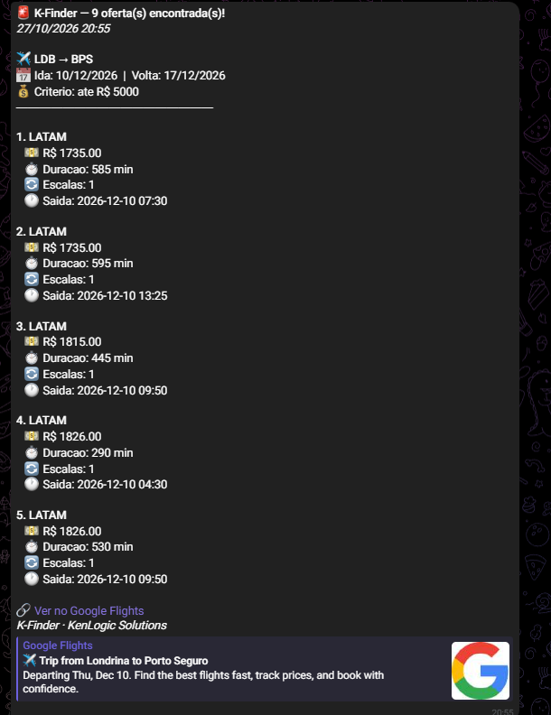

# ✈️ K-Finder

Monitor de preços de passagens aéreas em Python. O usuário cadastra rotas e um preço máximo por um bot do Telegram; o sistema consulta voos do Google Flights pela plataforma Apify e avisa por Telegram e e-mail quando encontra uma oferta dentro do limite definido.

> Projeto pessoal de estudo, desenvolvido para praticar consumo de APIs, automação e integração entre serviços. Veja a seção [Estado atual](#estado-atual) para saber exatamente o que já foi validado.

## Estado atual

| Parte | Situação |
|---|---|
| Busca de voos via Apify | ✅ Funciona. A execução do actor conclui com sucesso e o resultado é lido pelo código |
| Bot do Telegram (cadastro de rotas, `/buscar_agora`) | ✅ Responde e executa a busca. Rodando no Fly.io |
| Alertas por Telegram e e-mail | 🔄 Implementado, em validação |
| Execução agendada (GitHub Actions, a cada 6 h) | 🔄 Configurada, em validação |
| Controle de acesso multiusuário (aprovação pelo admin) | 🧪 Implementado, ainda sem testes com outros usuários |
| Histórico de preços | ⚠️ Funciona dentro de uma execução. No GitHub Actions, o histórico não é mantido entre execuções |
| Testes automatizados | ❌ Não há |

## Demonstração do projeto

O K-Finder permite configurar rotas, definir um preço máximo e iniciar buscas de passagens diretamente pelo Telegram.

### 1. Menu do bot

Interface inicial e opções disponíveis para interagir com o K-Finder.


### 2. Seleção de locais

Escolha da origem e do destino da viagem.


### 3. Seleção das datas

Configuração das datas da viagem.


### 4. Definição de preços

Escolha do preço máximo para filtrar as passagens.


### 5. Confirmação do cadastro

Exemplo da confirmação após adicionar uma rota.


### 6. Busca manual

Execução de uma busca de passagens pelo bot.


### 7. Resultado da busca

Exemplo dos resultados retornados pelo sistema após consultar os voos.



> As imagens demonstram o fluxo de utilização do bot. Consulte a tabela de estado atual para distinguir funcionalidades validadas das que ainda estão em teste.

## Como funciona

```text
Usuário ──(Telegram)──► bot.py ──► config.json
                             │
              GitHub Actions (cron 6 h)
                 ou /buscar_agora
                             ▼
                         kfinder.py
                             │
                  Apify (Google Flights)
                             │
                    Filtragem por preço
                             │
                  historico_precos.json
                             │
                   Telegram + e-mail
```

1. O usuário escolhe origem, destino, datas e preço máximo pelo Telegram.
2. O `kfinder.py` consulta os voos da rota usando um actor do Apify.
3. Os voos encontrados são filtrados e comparados com o histórico disponível.
4. Quando as condições de alerta são atendidas, o sistema pode enviar informações sobre companhia, preço, duração, escalas e link para a busca no Google Flights.

## Funcionalidades

- Cadastro, listagem, edição e remoção de rotas pelo Telegram (`/adicionar`, `/listar`, `/editar`, `/remover`).
- Seleção de cidades, datas por calendário e preço por botões inline.
- Busca manual com `/buscar_agora`.
- Suporte a várias rotas por usuário e controle de acesso com aprovação do administrador (`/admin`).
- Alertas por Telegram e e-mail em HTML, com link para o Google Flights.
- Busca agendada pelo GitHub Actions, com possibilidade de execução manual pela aba Actions.
- Credenciais lidas de variáveis de ambiente, sem chaves diretamente no código.

## Tecnologias

Python 3.12 · `requests` · `python-dotenv` · `apify-client` · Telegram Bot API · SMTP (Gmail) · GitHub Actions · Docker · Fly.io

## Estrutura do projeto

```text
K-Finder/
├── bot.py
├── kfinder.py
├── config.json
├── historico_precos.json
├── Dockerfile
├── fly.toml
├── requirements.txt
├── .env.example
├── .gitignore
├── docs/
│   └── images/
│       ├── menu.png
│       ├── lugares.png
│       ├── data.png
│       ├── precos.png
│       ├── adicionado.png
│       ├── procurar-agora.png
│       └── resultado.png
└── .github/
    └── workflows/
        └── busca.yml
```

> A estrutura acima é ilustrativa. Mantenha no README apenas os arquivos e pastas que realmente existem no repositório.

## Configuração

Crie um arquivo `.env` local com base no `.env.example`. **Nunca publique o `.env` nem compartilhe tokens ou senhas.**

| Variável | Finalidade |
|---|---|
| `APIFY_TOKEN` | Token da API do Apify |
| `TELEGRAM_TOKEN` | Token do bot, gerado pelo @BotFather |
| `TELEGRAM_CHAT_ID` | ID do chat do administrador |
| `EMAIL_REMETENTE` | Conta Gmail que envia os alertas |
| `EMAIL_SENHA_APP` | Senha de app do Gmail |
| `EMAIL_DESTINATARIO` | E-mail que recebe os alertas |

## Como executar

### Localmente

Instale as dependências:

```bash
pip install -r requirements.txt
```

Inicie o bot:

```bash
python bot.py
```

Para executar uma busca diretamente pelo script:

```bash
python kfinder.py
```

Os comandos e requisitos de configuração podem variar conforme o estado atual do código e das credenciais.

### GitHub Actions

Cadastre as variáveis necessárias em **Settings → Secrets and variables → Actions**. O workflow está configurado para execução periódica a cada seis horas e pode ser disparado manualmente, desde que o arquivo e os secrets estejam configurados corretamente.

### Fly.io

Configure os secrets necessários no Fly.io e faça o deploy conforme a configuração do projeto. Não coloque valores reais de tokens ou senhas no README.

## Limitações conhecidas

- **Histórico no GitHub Actions:** o workflow não persiste automaticamente o `historico_precos.json` entre execuções, podendo repetir alertas.
- **Configurações separadas:** as rotas cadastradas pelo bot no Fly.io e as rotas lidas pelo GitHub Actions não são sincronizadas automaticamente.
- **Persistência no Fly.io:** sem armazenamento persistente configurado, alterações nos arquivos locais do container podem ser perdidas em novos deploys.
- **Dependência externa:** a coleta de dados depende de um actor de terceiros no Apify.
- **Testes:** o projeto ainda não possui testes automatizados.

## Próximos passos

- Implementar persistência para histórico e rotas.
- Unificar a fonte de configuração do bot e do agendamento.
- Adicionar testes automatizados.
- Fixar e revisar as versões das dependências.
- Validar o envio de alertas por Telegram e e-mail em diferentes cenários.

## Segurança

- Manter tokens e senhas em variáveis de ambiente e secrets.
- Manter `.env` no `.gitignore`.
- Usar `.env.example` somente com nomes de variáveis e valores fictícios.
- Verificar o histórico do Git antes de publicar alterações, pois o `.gitignore` não remove secrets que já tenham sido commitados anteriormente.

## Autor

**Gabriel Kenzo**

[GitHub](https://github.com/KenzoWaka10) · [LinkedIn](https://linkedin.com/in/gabriel-kenzo-5b86a52a9)
